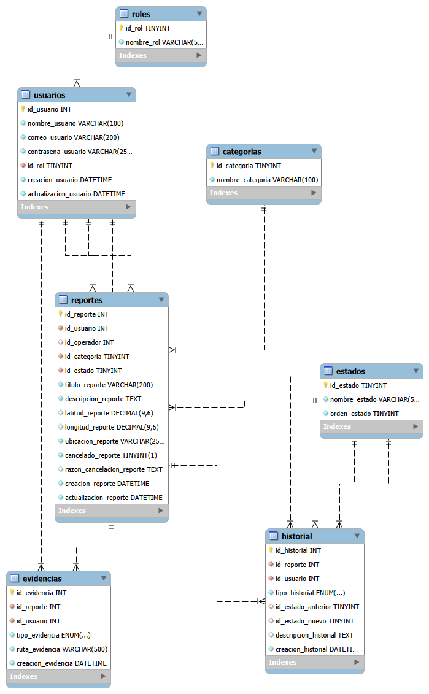

# Base de datos de Waypoint

MySQL 8.4 con 7 tablas. El esquema lo manejan las migraciones de Prisma (`backend/prisma/`). Esta carpeta tiene el modelo, el script completo y los acuerdos con la API.

## Archivos

| Archivo | Qué es |
|---|---|
| `modelo_er.png` | Diagrama entidad-relación final |
| `waypoint.mwb` | El modelo en MySQL Workbench, del que sale el diagrama |
| `waypoint.sql` | El esquema final completo en un solo script: tablas, llaves foráneas, índices y `CHECK`. Es el mismo que dejan las migraciones |
| `acuerdos-bd-api.md` | Decisiones de la BD que afectan a la API (roles, contraseñas, estados, evidencias) |
| `init/01-shadow.sql` | Lo corre Docker la primera vez: crea `waypoint_shadow`, la BD auxiliar que usa `npm run db:migrate` |

El esquema "oficial" son las migraciones de `backend/prisma/migrations/` (`esquema_inicial` y `revision_restricciones`). `waypoint.sql` es una copia para leerlo de corrido o para crear la BD sin Node.

## Modelo



| Tabla | Guarda | Se relaciona con |
|---|---|---|
| `roles` | `usuario` y `operador` | `usuarios` |
| `usuarios` | Cuentas. El correo es único sin importar mayúsculas y la contraseña es un hash de bcrypt | `roles`; crea `reportes`, los atiende como operador, sube `evidencias` y hace movimientos en `historial` |
| `categorias` | Tipos de barrera (rampa, elevador, señalización...) | `reportes` |
| `estados` | Los 4 pasos de un reporte, con su orden: Reportado (1) → En análisis (2) → En atención (3) → Resuelto (4) | `reportes` (estado actual) e `historial` (estado anterior y nuevo) |
| `reportes` | Cada barrera reportada: texto, ubicación, coordenadas opcionales, estado, operador asignado y si se canceló | `usuarios` (dos veces: creador y operador), `categorias`, `estados` |
| `evidencias` | Las fotos: las del reporte (`reporte`) y las de la atención (`atencion`) | `reportes`, `usuarios` |
| `historial` | Cada movimiento de un reporte: creación, asignación, cambio de estado, acción correctiva, cancelación | `reportes`, `usuarios`, `estados` |

Reglas del modelo:

- **Nada se borra.** Un reporte se cancela (`cancelado_reporte = 1`), y el historial y las evidencias solo crecen. Todas las llaves foráneas son `ON DELETE RESTRICT`.
- **El historial se escribe en la misma transacción** que el cambio que registra: o se guardan los dos o ninguno (ver `docs/db-functions.md`).
- **La BD rechaza datos inconsistentes por sí misma** con 13 `CHECK`: coordenadas en rango y juntas, textos sin vacíos, razón de cancelación solo si está cancelado, los estados correctos en cada tipo de movimiento, etc. El detalle y lo que revisa la API en su lugar está en `docs/restricciones-bd.md`.

## Crear la BD desde cero

Con [Docker Desktop](https://www.docker.com/products/docker-desktop/) y Node 22. Todo desde la raíz del repo:

1. Copiar `.env.example` a `.env` y poner las contraseñas (las reales se pasan por privado).
2. Levantar MySQL y Redis:

   ```bash
   docker compose up -d
   docker compose ps        # los dos deben decir "healthy"
   ```

3. Crear las tablas y cargar los datos iniciales:

   ```bash
   cd backend
   npm install
   npm run db:deploy        # aplica las migraciones
   npm run db:generate      # genera el cliente de Prisma
   npm run db:seed          # roles, categorías, los 4 estados y el operador de prueba
   ```

Los detalles (puertos ocupados, contraseñas con caracteres raros, la BD auxiliar) están en la sección **Base de datos** del [README principal](../README.md#base-de-datos).

### Comprobar que quedó bien

```bash
npm run db:status        # "Database schema is up to date!"
npm test                 # las pruebas de integración usan la BD real
```

O directo en MySQL (`docker compose exec mysql mysql -u<usuario> -p waypoint`):

```sql
SELECT COUNT(*) FROM estados;     -- 4
SELECT COUNT(*) FROM roles;       -- 2
SELECT COUNT(*) FROM information_schema.CHECK_CONSTRAINTS
  WHERE CONSTRAINT_SCHEMA = 'waypoint';   -- 13
```

### Sin Node (solo el script)

Para revisar el modelo en Workbench o en otra máquina sin el backend:

```bash
docker compose exec -T mysql mysql -uroot -p < database/waypoint.sql
```

Crea las tablas vacías: sin los datos de la semilla y sin la tabla `_prisma_migrations`. Si después se quiere usar con el backend, es mejor borrar esa BD y crearla con los pasos de arriba, para que Prisma sepa qué migraciones ya están aplicadas.

## En el servidor

La BD del droplet de DigitalOcean se levanta con `docker-compose.prod.yml` y se migra por un túnel SSH: ver `docs/despliegue-bd.md`. Para entrar al servidor: `docs/acceso-servidor.md`.

## Si cambia el esquema

1. Cambiar `backend/prisma/schema.prisma` y correr `npm run db:migrate` (crea la migración nueva). Un `CHECK` se agrega a mano en el `migration.sql`, porque Prisma no los genera.
2. Actualizar `waypoint.sql` para que siga igual a las migraciones.
3. Si cambian tablas, columnas o relaciones, actualizar `waypoint.mwb` en Workbench y volver a exportar `modelo_er.png`.
4. Si cambia una restricción, actualizar `docs/restricciones-bd.md`.

## Más documentación

| Documento | Qué tiene |
|---|---|
| `docs/db-functions.md` | Las funciones de `backend/src/db` que usa la API, con lo que reciben y devuelven |
| `docs/restricciones-bd.md` | Llaves foráneas, valores únicos, `CHECK` e índices |
| `docs/despliegue-bd.md` | Cómo levantar la BD en el servidor |
| `docs/pruebas-middlewares.md` | Qué pasa cuando la BD o Redis no responden |
