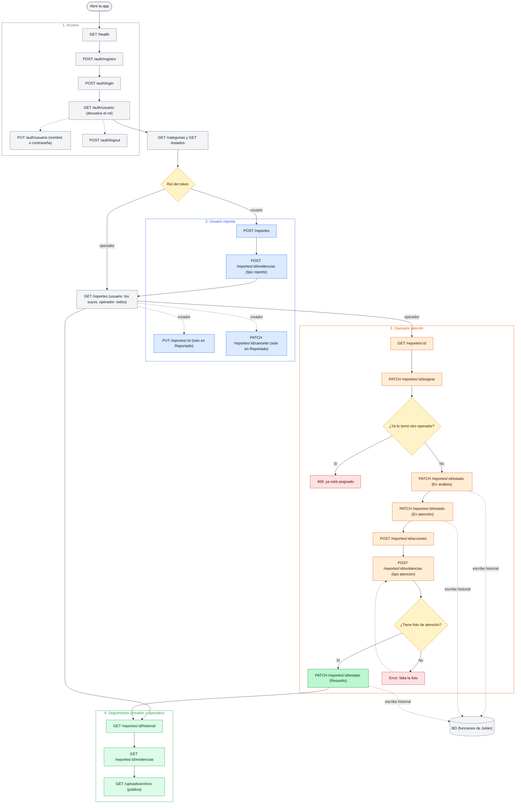

# API de Waypoint

> **Versión 1: contrato de la API (issue #9).** Rutas, quién puede usarlas, lo que manda la app, lo que responde la API y sus errores. Se congela en la reunión del #10; después de eso, cualquier cambio se habla con el equipo antes de hacerse.

## Flujo

Cómo se usan los endpoints desde que se abre la app hasta que un reporte queda Resuelto. Las líneas punteadas son pasos opcionales. Versión editable en FigJam: [Flujo de endpoints de la API](https://www.figma.com/board/mJlzCNB4CAdCga5UVcq4mk).



## Roles

| Rol | Quién es |
|---|---|
| `usuario` | Reporta obstáculos y consulta el seguimiento de sus reportes |
| `operador` | Analiza los reportes, cambia su estado, documenta las acciones correctivas y sube la foto de la atención |

Todas las cuentas que se crean con `POST /auth/registro` nacen como `usuario`. Los operadores vienen de la semilla de la BD.

En las tablas, **"creador"** no es un rol: es el usuario que hizo ese reporte. Un usuario no puede ver ni modificar los reportes de otro.

Los permisos se comprueban en el backend en cada ruta. Las rutas que no son públicas piden el token del login en el encabezado `Authorization: Bearer <token>`.

## Estados

`Reportado → En análisis → En atención → Resuelto`

- Solo el operador cambia el estado, un paso a la vez. No hay saltos ni retrocesos.
- Solo el operador asignado al reporte puede cambiar su estado.
- Para pasar a Resuelto debe existir al menos una evidencia de tipo `atencion`.
- Los estados viven en la tabla `estados` con su `orden_estado` (Reportado = 1, En análisis = 2, En atención = 3, Resuelto = 4). Un cambio es válido solo si el orden del estado nuevo es el del actual + 1. El orden nunca se toma del id.
- Un reporte nuevo nace en el estado con orden 1.
- Cada operación sobre un reporte queda en el historial con su tipo: `creacion`, `edicion`, `asignacion`, `cambio_estado`, `accion_correctiva` y `cancelacion`.

## Nombres de los campos

El JSON usa los mismos nombres que las columnas de la BD: snake_case con sufijo (`nombre_usuario`, `descripcion_reporte`, `id_reporte`). Así la API no traduce nombres y lo que devuelve la BD es lo que recibe la app.

`contrasena_usuario` nunca aparece en una respuesta.

El modelo completo está en `docs/db/` y los acuerdos entre la BD y la API en `docs/db/acuerdos-bd-api.md`.

Las fechas se devuelven en formato ISO 8601 (`2026-11-19T18:30:00Z`).

## Autenticación

- El login y el registro devuelven un **token**. La app lo guarda y lo manda en cada petición protegida:

  ```
  Authorization: Bearer <token>
  ```

- Si el token falta, es inválido o ya venció, cualquier ruta protegida responde `401 NO_AUTENTICADO` y la app regresa al login.
- **Cerrar sesión** invalida el token también en el backend (`POST /auth/logout`), no solo en la app. Así, si alguien interceptó el token, deja de servir en cuanto el usuario cierra sesión. Después la app borra el token guardado.
- La contraseña nunca se devuelve en una respuesta.

Cómo se genera y se verifica el token, cuánto dura, qué lleva dentro y cómo se hace el hash de la contraseña lo define Julián en el middleware de autenticación (#22). Este contrato solo fija cómo lo recibe y lo manda la app.

Reglas de validación de los datos de la cuenta, iguales a los límites de la BD. Las aplica el middleware de validación (#34):

| Campo | Regla |
|---|---|
| `nombre_usuario` | Obligatorio, de 1 a 100 caracteres |
| `correo_usuario` | Obligatorio, formato de correo, hasta 200 caracteres |
| `contrasena_usuario` | Obligatoria, mínimo 8 caracteres |

## Errores

Todas las respuestas de error tienen la misma forma, sin importar el código HTTP. Así la app maneja todos los errores en un solo lugar.

```json
{
  "error": {
    "codigo": "REPORTE_YA_ASIGNADO",
    "mensaje": "Otro operador ya tomó este reporte"
  }
}
```

- `codigo` es fijo y en mayúsculas.
- `mensaje` es texto para mostrar al usuario.

Los errores de validación agregan `campos`, con el problema de cada campo del formulario:

```json
{
  "error": {
    "codigo": "VALIDACION",
    "mensaje": "Hay campos inválidos",
    "campos": {
      "correo_usuario": "Formato inválido",
      "titulo_reporte": "Es obligatorio"
    }
  }
}
```

La app decide que mostrar: puede pintar cada mensaje de `campos` debajo de su campo o mostrar solo el `mensaje` general.

### Reglas de seguridad

- **Ningún error expone detalles** (consultas SQL, trazas, rutas de archivos, o hasta código). Si existe un fallo en el servidor responde siempre igual y el detalle se queda en los logs del servidor:

  ```json
  { "error": { "codigo": "ERROR_INTERNO", "mensaje": "Ocurrió un error en el servidor" } }
  ```

- **Lo que muestra el login** Correo inexistente y contraseña incorrecta dan la misma respuesta, sin `campos`, para no revelar qué informacion se encuentra en la base de datos:

  ```json
  { "error": { "codigo": "CREDENCIALES_INVALIDAS", "mensaje": "Correo o contraseña incorrectos" } }
  ```

- **`campos` solo describe el formato** ("Formato inválido", "Es obligatorio"), nunca el contenido de la BD ("Este correo no existe").
- **El login limita los intentos.** Después de varios intentos fallidos seguidos, responde `429`, se usara un rate_limit.

### Códigos HTTP

Respuestas correctas:

| Código | Cuándo |
|---|---|
| `200` | La petición salió bien y devuelve datos (consultas, ediciones, cambios de estado, cancelaciones) |
| `201` | Se creó algo nuevo (cuenta, reporte, evidencia, acción correctiva) |
| `204` | Se completó sin nada que devolver (cerrar sesión) |

Errores, con su `codigo`:

| HTTP | `codigo` | Cuándo |
|---|---|---|
| `400` | `VALIDACION` | Falta un campo o tiene formato inválido. Es el único que lleva `campos` |
| `401` | `NO_AUTENTICADO` | No hay token, es inválido o ya expiró. La app manda al usuario al login |
| `401` | `CREDENCIALES_INVALIDAS` | Correo o contraseña incorrectos en el login |
| `403` | `SIN_PERMISO` | El rol no puede usar esa ruta (un `usuario` en administración) o el operador no es el asignado al reporte |
| `404` | `NO_ENCONTRADO` | El reporte o la evidencia no existe. Un `usuario` también lo recibe si pide un reporte de otra persona, para no confirmar que existe |
| `404` | `RUTA_NO_ENCONTRADA` | La ruta no existe en la API |
| `409` | `CORREO_REGISTRADO` | El correo del registro ya tiene cuenta |
| `409` | `REPORTE_YA_ASIGNADO` | Otro operador tomó el reporte primero |
| `409` | `ESTADO_DESACTUALIZADO` | Alguien cambió el estado del reporte mientras se pedía el cambio. La app vuelve a consultar el reporte |
| `413` | `ARCHIVO_DEMASIADO_GRANDE` | La foto pasa del tamaño máximo (`MAX_UPLOAD_MB`) |
| `415` | `TIPO_ARCHIVO_INVALIDO` | El archivo no es una imagen JPEG |
| `422` | `CONTRASENA_INCORRECTA` | Al editar el perfil, la contraseña actual no coincide. Es distinto de `401` para que la app no lo confunda con una sesión vencida |
| `422` | `REPORTE_NO_EDITABLE` | El reporte ya no admite ese cambio: editarlo, cancelarlo o subir fotos fuera del estado permitido (ver cada endpoint) |
| `422` | `TRANSICION_INVALIDA` | El cambio de estado se salta un paso, retrocede o el reporte ya está Resuelto |
| `422` | `FALTA_EVIDENCIA_ATENCION` | Se pide Resuelto sin ninguna foto de tipo `atencion` |
| `429` | `DEMASIADOS_INTENTOS` | Demasiados intentos de login fallidos seguidos |
| `500` | `ERROR_INTERNO` | Cualquier falla del servidor o de la BD |

La diferencia entre `409` y `422`: el `409` es un choque con otra persona o con datos que ya existen (otro operador llegó primero, el correo ya está registrado); el `422` es una petición bien formada que rompe una regla del sistema (saltarse un estado, resolver sin foto).

## Endpoints

### Acceso

| Método | Ruta | Quién | Para qué | Issue |
|---|---|---|---|---|
| `GET` | `/health` | Público | Comprobar que el servidor responde. La app lo usa para saber si hay conexión | #17 |
| `POST` | `/auth/registro` | Público | Crear una cuenta con rol `usuario` | #24 |
| `POST` | `/auth/login` | Público | Iniciar sesión y recibir el token | #24 |
| `GET` | `/auth/usuario` | Autenticado | Datos del usuario de la sesión, incluido su rol. Es la misma ruta para `usuario` y `operador` | #24 |
| `PUT` | `/auth/usuario` | Autenticado | Editar su nombre o su contraseña desde la pantalla de perfil. Para cambiar la contraseña pide la actual. No permite cambiar el rol | #24 |
| `POST` | `/auth/logout` | Autenticado | Cerrar sesión: el token deja de ser válido en el servidor | #24 |

### Catálogos

| Método | Ruta | Quién | Para qué | Issue |
|---|---|---|---|---|
| `GET` | `/categorias` | Autenticado | Lista de categorías para el formulario. Solo lectura: las categorías vienen de la semilla de la BD | #31 |
| `GET` | `/estados` | Autenticado | Los 4 estados en orden, para que la app no los tenga fijos en su código (filtros y seguimiento) | #31 |

### Reportes

| Método | Ruta | Quién | Para qué | Issue |
|---|---|---|---|---|
| `POST` | `/reportes` | `usuario` | Crear un reporte con título, categoría, descripción y ubicación. Nace en Reportado | #30 |
| `GET` | `/reportes` | Autenticado | Un solo endpoint: el `usuario` recibe solo los suyos y el `operador` recibe todos. Filtros opcionales: `?id_estado=&id_categoria=&q=&cancelados=` | #30 |
| `GET` | `/reportes/:id` | Creador u `operador` | Detalle del reporte | #30 |
| `PUT` | `/reportes/:id` | Creador, solo en Reportado | Modificar el reporte. Cuando el operador lo empieza a analizar ya no se puede editar | #30 |
| `PATCH` | `/reportes/:id/cancelar` | Creador, solo en Reportado | Cancelar el reporte con un motivo. No se borra de la BD: solo queda marcado como cancelado | #30 |

### Evidencias

| Método | Ruta | Quién | Para qué | Issue |
|---|---|---|---|---|
| `POST` | `/reportes/:id/evidencias` | Creador u `operador` asignado | Subir una foto. El backend decide el tipo según el rol: `reporte` si la sube el usuario, `atencion` si la sube el operador | #45 |
| `GET` | `/reportes/:id/evidencias` | Creador u `operador` | Fotos del reporte, de los dos tipos | #45 |
| `GET` | `/uploads/<archivo>` | Público | Mostrar la imagen en la app. No es un controlador: es la carpeta de imágenes servida por el servidor | #45 |

El reporte se crea primero (`POST /reportes`, en JSON) y las fotos se suben después, una por petición. Así un solo endpoint de subida sirve para los dos roles.

El nombre del archivo lo genera el servidor (un UUID), nunca se usa el que manda la app, para evitar rutas maliciosas como `../../archivo`. En la BD solo se guarda la ruta.

Una foto subida no se puede borrar: queda como evidencia del reporte, aunque se haya subido por error. Si hace falta, se sube otra.

### Historial

| Método | Ruta | Quién | Para qué | Issue |
|---|---|---|---|---|
| `GET` | `/reportes/:id/historial` | Creador u `operador` | Seguimiento completo: quién hizo cada cambio, cuándo y de qué estado a cuál | #46 |

### Administración (solo `operador`)

| Método | Ruta | Para qué | Issue |
|---|---|---|---|
| `PATCH` | `/reportes/:id/asignar` | El operador toma el reporte. Si otro operador ya lo tomó, responde error | #38 |
| `PATCH` | `/reportes/:id/estado` | Pasar al siguiente estado: la app manda el estado nuevo y la API valida que sea el siguiente y, para Resuelto, que exista la foto de atención | #36, #37, #38 |
| `POST` | `/reportes/:id/acciones` | Registrar una acción correctiva (por ejemplo, "se colocó una rampa temporal"). Se guarda en el historial con tipo `accion_correctiva` y no cambia el estado | #38 |

Se dejan separados a propósito, en lugar de un solo `PATCH /reportes/:id` con campos opcionales: cada uno tiene permisos, validaciones e historial distintos, y así se prueban y se explican por separado.

Un usuario común que llame a estas rutas recibe `403`.

## Detalle de los endpoints

Cada endpoint con lo que manda la app, lo que responde la API y sus errores. Todas las rutas pueden responder además `500 ERROR_INTERNO`, y las protegidas `401 NO_AUTENTICADO`.

### Acceso

#### `GET /health`

Sin cuerpo. Respuesta `200`:

```json
{ "estado": "ok" }
```

#### `POST /auth/registro`

Petición:

```json
{
  "nombre_usuario": "Ana López",
  "correo_usuario": "ana@ejemplo.com",
  "contrasena_usuario": "una-contraseña-segura"
}
```

Respuesta `201`. Devuelve el token para que la app entre sin pedir el login otra vez:

```json
{
  "token": "<token>",
  "usuario": {
    "id_usuario": 5,
    "nombre_usuario": "Ana López",
    "correo_usuario": "ana@ejemplo.com",
    "nombre_rol": "usuario",
    "creacion_usuario": "2026-11-19T18:30:00Z"
  }
}
```

La cuenta siempre nace con rol `usuario`, aunque la petición mande otro.

Errores: `400 VALIDACION`, `409 CORREO_REGISTRADO`.

#### `POST /auth/login`

Petición:

```json
{
  "correo_usuario": "ana@ejemplo.com",
  "contrasena_usuario": "una-contraseña-segura"
}
```

Respuesta `200`: igual que el registro (`token` y `usuario`).

Errores: `400 VALIDACION` (falta un campo), `401 CREDENCIALES_INVALIDAS`, `429 DEMASIADOS_INTENTOS`.

#### `GET /auth/usuario`

Sin cuerpo; solo el token. Respuesta `200`:

```json
{
  "usuario": {
    "id_usuario": 5,
    "nombre_usuario": "Ana López",
    "correo_usuario": "ana@ejemplo.com",
    "nombre_rol": "usuario",
    "creacion_usuario": "2026-11-19T18:30:00Z"
  }
}
```

La app usa `nombre_rol` para decidir qué pantallas mostrar.

#### `PUT /auth/usuario`

Petición con al menos uno de los cambios. Para cambiar la contraseña se manda la actual y la nueva:

```json
{
  "nombre_usuario": "Ana María López",
  "contrasena_actual": "una-contraseña-segura",
  "contrasena_nueva": "otra-contraseña-segura"
}
```

Respuesta `200`: el `usuario` actualizado, igual que en `GET /auth/usuario`.

El correo y el rol no se pueden cambiar; si la petición los trae, se ignoran.

Errores: `400 VALIDACION`, `422 CONTRASENA_INCORRECTA` (la contraseña actual no coincide).

#### `POST /auth/logout`

Sin cuerpo; solo el token. Respuesta `204` sin contenido.

A partir de ese momento el token responde `401 NO_AUTENTICADO` en cualquier ruta, aunque no haya vencido. Si el token ya no era válido, también responde `204`, para que la app pueda cerrar sesión sin importar el estado del token.

Cómo se invalida el token (sesiones guardadas en la BD, lista de tokens revocados u otra forma) lo define Julián junto con el middleware de autenticación (#22).

### Catálogos

#### `GET /categorias`

Sin cuerpo. Respuesta `200`, ordenada por id:

```json
{
  "categorias": [
    { "id_categoria": 1, "nombre_categoria": "Rampas y accesos" },
    { "id_categoria": 2, "nombre_categoria": "Elevadores" }
  ]
}
```

#### `GET /estados`

Sin cuerpo. Respuesta `200`, ordenada por `orden_estado`:

```json
{
  "estados": [
    { "id_estado": 1, "nombre_estado": "Reportado", "orden_estado": 1 },
    { "id_estado": 2, "nombre_estado": "En análisis", "orden_estado": 2 },
    { "id_estado": 3, "nombre_estado": "En atención", "orden_estado": 3 },
    { "id_estado": 4, "nombre_estado": "Resuelto", "orden_estado": 4 }
  ]
}
```

La app usa `orden_estado` para pintar el avance del seguimiento y para saber cuál es el siguiente estado.

### Reportes

#### Cómo se ve un reporte

Todas las rutas de reportes devuelven el reporte con esta forma. La categoría, el estado, el creador y el operador asignado vienen como objetos, para que la app no tenga que pedirlos aparte:

```json
{
  "id_reporte": 7,
  "titulo_reporte": "Rampa rota en el edificio 1",
  "descripcion_reporte": "La rampa de la entrada norte tiene una grieta y una parte hundida.",
  "ubicacion_reporte": "Edificio 1, entrada norte",
  "latitud_reporte": 21.913560,
  "longitud_reporte": -102.315020,
  "cancelado_reporte": false,
  "motivo_cancelacion_reporte": null,
  "creacion_reporte": "2026-11-19T18:30:00Z",
  "actualizacion_reporte": "2026-11-19T18:30:00Z",
  "categoria": { "id_categoria": 1, "nombre_categoria": "Rampas y accesos" },
  "estado": { "id_estado": 1, "nombre_estado": "Reportado", "orden_estado": 1 },
  "usuario": { "id_usuario": 5, "nombre_usuario": "Ana López" },
  "operador": null
}
```

- `latitud_reporte` y `longitud_reporte` son `null` si el usuario no dio permiso de ubicación.
- `motivo_cancelacion_reporte` es `null` mientras el reporte no está cancelado.
- `operador` es `null` mientras nadie toma el reporte; después trae `{ "id_usuario": 12, "nombre_usuario": "..." }`.
- Del creador y del operador solo se devuelve el id y el nombre, nunca el correo.

Reglas de validación de un reporte, iguales a los límites de la BD:

| Campo | Regla |
|---|---|
| `titulo_reporte` | Obligatorio, de 1 a 200 caracteres |
| `descripcion_reporte` | Obligatoria, de 1 a 2000 caracteres. La columna de la BD admite más; el límite lo pone la API para evitar textos enormes |
| `id_categoria` | Obligatorio, una categoría que exista |
| `ubicacion_reporte` | Obligatoria, de 1 a 255 caracteres. Es la que se usa si no hay GPS |
| `latitud_reporte` | Opcional, entre -90 y 90, hasta 6 decimales |
| `longitud_reporte` | Opcional, entre -180 y 180, hasta 6 decimales |

La latitud y la longitud van juntas: o vienen las dos o ninguna.

#### `POST /reportes`

Solo el rol `usuario`. Petición:

```json
{
  "titulo_reporte": "Rampa rota en el edificio 1",
  "descripcion_reporte": "La rampa de la entrada norte tiene una grieta y una parte hundida.",
  "id_categoria": 1,
  "ubicacion_reporte": "Edificio 1, entrada norte",
  "latitud_reporte": 21.913560,
  "longitud_reporte": -102.315020
}
```

Respuesta `201`: `{ "reporte": { ... } }` con la forma de arriba, en estado Reportado y con `operador` en `null`. En la misma operación se escribe el historial de tipo `creacion`.

Las fotos se suben después con `POST /reportes/:id/evidencias`.

Errores: `400 VALIDACION`, `403 SIN_PERMISO` (un operador intenta crear un reporte).

#### `GET /reportes`

Sin cuerpo. Filtros opcionales en la URL, que se pueden combinar:

| Parámetro | Filtra por |
|---|---|
| `id_estado` | Estado del reporte |
| `id_categoria` | Categoría |
| `q` | Texto que aparezca en el título, la descripción o la ubicación |
| `cancelados` | Con `true` devuelve solo los reportes cancelados (por ejemplo, para una pestaña de "Cancelados"). Sin este filtro no se incluyen |

Ejemplo: `GET /reportes?id_estado=2&q=rampa`

Respuesta `200`, con los más recientes primero:

```json
{
  "reportes": [
    { "id_reporte": 7, "titulo_reporte": "Rampa rota en el edificio 1" }
  ]
}
```

Cada elemento tiene la forma completa de un reporte; en el ejemplo se recortó. Por defecto no incluye los reportes cancelados; se piden con `?cancelados=true`. El `usuario` solo recibe los suyos y el `operador` recibe todos.

Errores: `400 VALIDACION` (un filtro con formato inválido).

#### `GET /reportes/:id`

Sin cuerpo. Respuesta `200`: `{ "reporte": { ... } }` con la forma de arriba. Si el reporte está cancelado, se devuelve igual con `cancelado_reporte` en `true`.

Errores: `404 NO_ENCONTRADO` (no existe, o es de otro usuario).

#### `PUT /reportes/:id`

Solo el creador, y solo mientras el reporte está en Reportado y no está cancelado. Se manda el reporte completo con los mismos campos y reglas que al crearlo:

```json
{
  "titulo_reporte": "Rampa rota en el edificio 1",
  "descripcion_reporte": "La grieta ya llega a la orilla de la rampa.",
  "id_categoria": 1,
  "ubicacion_reporte": "Edificio 1, entrada norte",
  "latitud_reporte": 21.913560,
  "longitud_reporte": -102.315020
}
```

Respuesta `200`: `{ "reporte": { ... } }` con los cambios. Se escribe el historial de tipo `edicion`.

La actualización lleva la condición del estado en el `WHERE`: si un operador lo pasó a En análisis mientras se editaba, no se aplica y responde `422`.

Errores: `400 VALIDACION`, `403 SIN_PERMISO` (un operador intenta editar), `404 NO_ENCONTRADO`, `422 REPORTE_NO_EDITABLE`.

#### `PATCH /reportes/:id/cancelar`

Cancela el reporte. Solo el creador, y solo mientras está en Reportado. Petición:

```json
{
  "motivo_cancelacion_reporte": "Ya lo repararon antes de que lo revisaran"
}
```

| Campo | Regla |
|---|---|
| `motivo_cancelacion_reporte` | Obligatorio, de 1 a 2000 caracteres |

El nombre del campo es una propuesta: se ajusta al de la columna que agregue Julián en el ERD.

Respuesta `200`: `{ "reporte": { ... } }` con `cancelado_reporte` en `true` y el motivo.

No se borra de la BD: se marca `cancelado_reporte` en `true`, se guarda el motivo y se escribe el historial de tipo `cancelacion`.

Errores: `400 VALIDACION` (falta el motivo o pasa del límite), `403 SIN_PERMISO` (un operador intenta cancelar), `404 NO_ENCONTRADO`, `422 REPORTE_NO_EDITABLE` (ya no está en Reportado o ya estaba cancelado).

### Evidencias

#### Cómo se ve una evidencia

```json
{
  "id_evidencia": 31,
  "tipo_evidencia": "reporte",
  "ruta_evidencia": "/uploads/3f2b8c1e-9a4d-4e7b-b1c2-5d6e7f8a9b0c.jpg",
  "creacion_evidencia": "2026-11-19T18:32:00Z",
  "usuario": { "id_usuario": 5, "nombre_usuario": "Ana López" }
}
```

`ruta_evidencia` es la dirección para mostrar la imagen con `GET /uploads/<archivo>`. `usuario` es quien subió la foto.

#### `POST /reportes/:id/evidencias`

Sube una foto por petición, como `multipart/form-data` con el campo `imagen`. Reglas del archivo:

- Solo JPEG. La app convierte la foto a JPEG antes de subirla, también las del iPhone, que se guardan en HEIC. El servidor revisa el contenido del archivo, no solo la extensión.
- Tamaño máximo: `MAX_UPLOAD_MB` del `.env` (5 MB en el ejemplo).
- El nombre lo genera el servidor; el nombre original se descarta.

Quién puede subir y de qué tipo queda la foto (la app no manda el tipo):

| Quién | Cuándo | Tipo |
|---|---|---|
| Creador del reporte | Mientras está en Reportado | `reporte` |
| Operador asignado | Mientras está en En análisis o En atención | `atencion` |

Respuesta `201`: `{ "evidencia": { ... } }` con la forma de arriba.

Errores: `400 VALIDACION` (no viene el campo `imagen`), `403 SIN_PERMISO` (no es el creador ni el operador asignado), `404 NO_ENCONTRADO`, `413 ARCHIVO_DEMASIADO_GRANDE`, `415 TIPO_ARCHIVO_INVALIDO`, `422 REPORTE_NO_EDITABLE` (el reporte ya no admite fotos de ese tipo).

#### `GET /reportes/:id/evidencias`

Sin cuerpo. Respuesta `200`, con las fotos de los dos tipos de la más antigua a la más reciente:

```json
{
  "evidencias": [
    { "id_evidencia": 31, "tipo_evidencia": "reporte" },
    { "id_evidencia": 40, "tipo_evidencia": "atencion" }
  ]
}
```

Cada elemento tiene la forma completa de una evidencia; en el ejemplo se recortó.

Errores: `404 NO_ENCONTRADO` (el reporte no existe o es de otro usuario).

#### `GET /uploads/<archivo>`

Devuelve la imagen tal cual (no JSON), con el tipo `image/jpeg`.

Es pública: no pide token, para que la app la muestre igual en web, iPhone y escritorio sin mandar el token en cada imagen. Nadie llega a una foto sin su enlace, porque el nombre es un UUID generado al azar que solo aparece en `ruta_evidencia`, y esa ruta solo la reciben quienes pueden ver el reporte.

Errores: `404 NO_ENCONTRADO`.

### Historial

#### `GET /reportes/:id/historial`

Sin cuerpo. Solo el creador o un operador. Respuesta `200`, de lo más antiguo a lo más reciente, como una línea de tiempo:

```json
{
  "historial": [
    {
      "id_historial": 101,
      "tipo_historial": "creacion",
      "estado_anterior": null,
      "estado_nuevo": { "id_estado": 1, "nombre_estado": "Reportado", "orden_estado": 1 },
      "descripcion_historial": null,
      "creacion_historial": "2026-11-19T18:30:00Z",
      "usuario": { "id_usuario": 5, "nombre_usuario": "Ana López" }
    },
    {
      "id_historial": 108,
      "tipo_historial": "cambio_estado",
      "estado_anterior": { "id_estado": 1, "nombre_estado": "Reportado", "orden_estado": 1 },
      "estado_nuevo": { "id_estado": 2, "nombre_estado": "En análisis", "orden_estado": 2 },
      "descripcion_historial": "Se revisó en sitio",
      "creacion_historial": "2026-11-20T09:15:00Z",
      "usuario": { "id_usuario": 12, "nombre_usuario": "Operador de prueba" }
    }
  ]
}
```

`usuario` es quien hizo el movimiento. Qué trae cada tipo:

| `tipo_historial` | `estado_anterior` y `estado_nuevo` | `descripcion_historial` |
|---|---|---|
| `creacion` | Solo `estado_nuevo` (Reportado) | `null` |
| `edicion` | `null` | `null` |
| `asignacion` | `null` | `null` |
| `cambio_estado` | Los dos | El comentario del operador, si lo mandó |
| `accion_correctiva` | `null` | La acción que se hizo |
| `cancelacion` | `null` | `null` |

El historial no se modifica ni se borra. La app puede filtrarlo por tipo si solo quiere mostrar, por ejemplo, los cambios de estado.

Errores: `404 NO_ENCONTRADO` (el reporte no existe o es de otro usuario).

### Administración

Las tres rutas son solo para el rol `operador`. Un `usuario` recibe `403 SIN_PERMISO`.

#### `PATCH /reportes/:id/asignar`

Sin cuerpo. El operador de la sesión toma el reporte. Respuesta `200`: `{ "reporte": { ... } }` con `operador` lleno. Se escribe el historial de tipo `asignacion`.

Si el reporte ya era de ese mismo operador, responde `200` sin cambios.

Errores: `403 SIN_PERMISO`, `404 NO_ENCONTRADO`, `409 REPORTE_YA_ASIGNADO` (otro operador lo tomó primero), `422 REPORTE_NO_EDITABLE` (está cancelado o Resuelto).

#### `PATCH /reportes/:id/estado`

Solo el operador asignado al reporte. La app manda el estado al que quiere pasar y, si quiere, un comentario:

```json
{
  "id_estado": 2,
  "descripcion_historial": "Se revisó en sitio"
}
```

| Campo | Regla |
|---|---|
| `id_estado` | Obligatorio, un estado que exista |
| `descripcion_historial` | Opcional, hasta 2000 caracteres |

La API compara el estado que manda la app con el actual:

| El estado que manda la app es… | Respuesta |
|---|---|
| El siguiente (orden actual + 1) | `200`: cambia el estado y escribe el historial de tipo `cambio_estado` |
| Igual al actual (alguien ya lo movió ahí) | `409 ESTADO_DESACTUALIZADO`: la app vuelve a consultar el reporte |
| Se salta un paso, retrocede, o el reporte ya está Resuelto | `422 TRANSICION_INVALIDA` |
| Resuelto, sin ninguna foto de tipo `atencion` | `422 FALTA_EVIDENCIA_ATENCION` |

La app manda el estado de destino, en lugar de pedir "el siguiente", para que una pantalla desactualizada o un doble clic no avancen el reporte dos veces.

Respuesta `200`: `{ "reporte": { ... } }` con el estado nuevo.

Errores: `400 VALIDACION`, `403 SIN_PERMISO` (no es el operador asignado), `404 NO_ENCONTRADO`, `409 ESTADO_DESACTUALIZADO`, `422 TRANSICION_INVALIDA`, `422 FALTA_EVIDENCIA_ATENCION`.

#### `POST /reportes/:id/acciones`

Solo el operador asignado, mientras el reporte está en En análisis o En atención. Petición:

```json
{
  "descripcion_historial": "Se colocó una rampa temporal mientras llega la reparación."
}
```

`descripcion_historial` es obligatoria, de 1 a 2000 caracteres.

Respuesta `201`: `{ "historial": { ... } }` con el renglón creado, de tipo `accion_correctiva`, con la forma de `GET /reportes/:id/historial`. No cambia el estado.

Errores: `400 VALIDACION`, `403 SIN_PERMISO`, `404 NO_ENCONTRADO`, `422 REPORTE_NO_EDITABLE` (el reporte no está en En análisis ni en En atención).

## Concurrencia

Si dos operadores intentan tomar el mismo reporte al mismo tiempo, no se usa un bloqueo. La actualización lleva la condición en el `WHERE` y la BD la ejecuta de forma atómica:

```sql
UPDATE reportes SET id_operador = 12 WHERE id_reporte = 7 AND id_operador IS NULL;
```

Si afecta 0 filas, otro operador llegó primero y la API responde `409 REPORTE_YA_ASIGNADO`. El cambio de estado funciona igual: `... WHERE id_reporte = 7 AND id_estado = <id del estado actual>`. Si el estado ya cambió, la API responde `409 ESTADO_DESACTUALIZADO` en lugar de pisar el cambio.

## Preguntas abiertas

**Para Julián (BD):**
1. Para `GET /reportes` con un solo endpoint, ¿tu función de listar puede recibir el id del usuario como filtro opcional?
2. Para la concurrencia, ¿tus funciones de asignar y de cambiar estado pueden devolver cuántas filas se actualizaron?
3. Para `PUT /auth/usuario`: ¿puedes agregar a `docs/db-functions.md` una función para actualizar nombre y hash de contraseña?