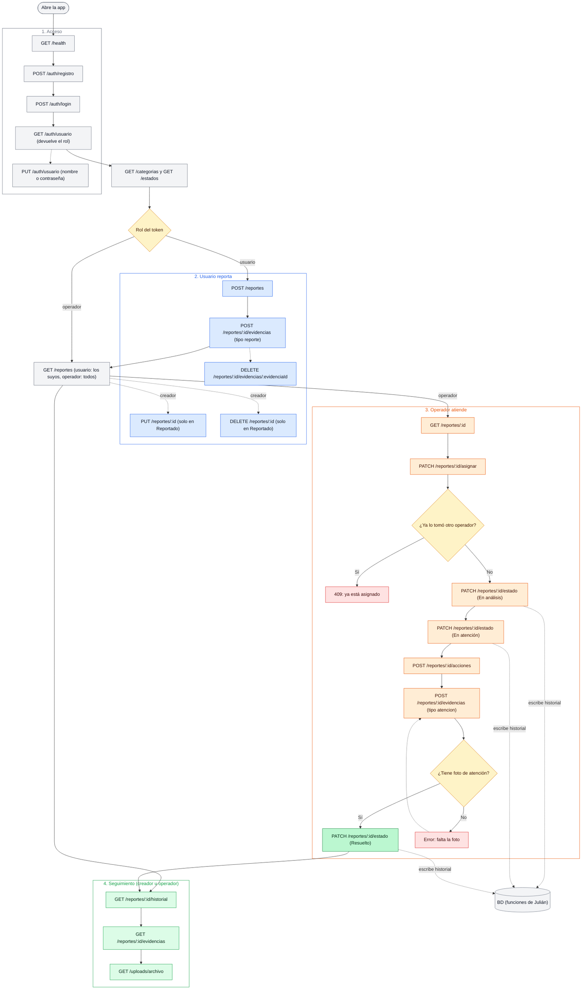

# API de Waypoint

> **Versión 0: borrador de endpoints (issue #6).** Aquí solo está la lista de rutas, quién puede usarlas y para qué. Los cuerpos JSON, las respuestas y los códigos de error se agregan en el contrato v1 (issue #9).

## Flujo

Cómo se usan los endpoints desde que se abre la app hasta que un reporte queda Resuelto. Las líneas punteadas son pasos opcionales. Versión editable en FigJam: [Flujo de endpoints de la API](https://www.figma.com/board/mJlzCNB4CAdCga5UVcq4mk).



## Roles

| Rol | Quién es |
|---|---|
| `usuario` | Reporta obstáculos y consulta el seguimiento de sus reportes |
| `operador` | Analiza los reportes, cambia su estado, documenta las acciones correctivas y sube la foto de la atención |

Todas las cuentas que se crean con `POST /auth/registro` nacen como `usuario`. Los operadores vienen de la semilla de la BD.

En las tablas, **"creador"** no es un rol: es el usuario que hizo ese reporte. Un usuario no puede ver ni modificar los reportes de otro.

Los permisos se comprueban en el backend en cada ruta. Las rutas que no son públicas piden el token del login en el encabezado `Authorization: Bearer <token>`.

## Estados

`Reportado → En análisis → En atención → Resuelto`

- Solo el operador cambia el estado, un paso a la vez. No hay saltos ni retrocesos.
- Solo el operador asignado al reporte puede cambiar su estado.
- Para pasar a Resuelto debe existir al menos una evidencia de tipo `atencion`.
- Los estados viven en la tabla `estados` con su `orden_estado` (Reportado = 1, En análisis = 2, En atención = 3, Resuelto = 4). Un cambio es válido solo si el orden del estado nuevo es el del actual + 1. El orden nunca se toma del id.
- Un reporte nuevo nace en el estado con orden 1.
- Cada operación sobre un reporte queda en el historial con su tipo: `creacion`, `edicion`, `asignacion`, `cambio_estado`, `accion_correctiva` y `cancelacion`.

## Nombres de los campos

La BD usa snake_case con sufijo (`nombre_usuario`, `descripcion_reporte`). La API responde en camelCase con el mismo sufijo (`nombreUsuario`, `descripcionReporte`), que es la convención de JavaScript y de Dart. Los ids siguen la misma regla: `id_reporte` se vuelve `idReporte`.

`contrasenaUsuario` nunca aparece en una respuesta.

Pendiente para la reunión del issue #10: si la traducción la hacen las funciones de la BD (con un alias en el `SELECT`) o los controladores.

El modelo completo está en `docs/db/` y los acuerdos entre la BD y la API en `docs/db/acuerdos-bd-api.md`.

Las fechas se devuelven en formato ISO 8601 (`2026-11-19T18:30:00Z`).

## Autenticación

- El login y el registro devuelven un **token**. La app lo guarda y lo manda en cada petición protegida:

  ```
  Authorization: Bearer <token>
  ```

- Si el token falta, es inválido o ya venció, cualquier ruta protegida responde `401 NO_AUTENTICADO` y la app regresa al login.
- **Cerrar sesión** no tiene endpoint: la app borra el token guardado.
- La contraseña nunca se devuelve en una respuesta.

Cómo se genera y se verifica el token, cuánto dura, qué lleva dentro y cómo se hace el hash de la contraseña lo define Julián en el middleware de autenticación (#22). Este contrato solo fija cómo lo recibe y lo manda la app.

Reglas de validación de los datos de la cuenta, iguales a los límites de la BD. Las aplica el middleware de validación (#34):

| Campo | Regla |
|---|---|
| `nombreUsuario` | Obligatorio, de 1 a 100 caracteres |
| `correoUsuario` | Obligatorio, formato de correo, hasta 200 caracteres |
| `contrasenaUsuario` | Obligatoria, mínimo 8 caracteres |

## Errores

Todas las respuestas de error tienen la misma forma, sin importar el código HTTP. Así la app maneja todos los errores en un solo lugar.

```json
{
  "error": {
    "codigo": "REPORTE_YA_ASIGNADO",
    "mensaje": "Otro operador ya tomó este reporte"
  }
}
```

- `codigo` es fijo y en mayúsculas.
- `mensaje` es texto para mostrar al usuario.

Los errores de validación agregan `campos`, con el problema de cada campo del formulario:

```json
{
  "error": {
    "codigo": "VALIDACION",
    "mensaje": "Hay campos inválidos",
    "campos": {
      "correoUsuario": "Formato inválido",
      "tituloReporte": "Es obligatorio"
    }
  }
}
```

La app decide que mostrar: puede pintar cada mensaje de `campos` debajo de su campo o mostrar solo el `mensaje` general.

### Reglas de seguridad

- **Ningún error expone detalles** (consultas SQL, trazas, rutas de archivos, o hasta código). Si existe un fallo en el servidor responde siempre igual y el detalle se queda en los logs del servidor:

  ```json
  { "error": { "codigo": "ERROR_INTERNO", "mensaje": "Ocurrió un error en el servidor" } }
  ```

- **Lo que muestra el login** Correo inexistente y contraseña incorrecta dan la misma respuesta, sin `campos`, para no revelar qué informacion se encuentra en la base de datos:

  ```json
  { "error": { "codigo": "CREDENCIALES_INVALIDAS", "mensaje": "Correo o contraseña incorrectos" } }
  ```

- **`campos` solo describe el formato** ("Formato inválido", "Es obligatorio"), nunca el contenido de la BD ("Este correo no existe").
- **El login limita los intentos.** Después de varios intentos fallidos seguidos, responde `429`, se usara un rate_limit.

### Códigos HTTP

Respuestas correctas:

| Código | Cuándo |
|---|---|
| `200` | La petición salió bien y devuelve datos (consultas, ediciones, cambios de estado) |
| `201` | Se creó algo nuevo (cuenta, reporte, evidencia, acción correctiva) |
| `204` | Se completó sin nada que devolver (cancelar un reporte, borrar una evidencia) |

Errores, con su `codigo`:

| HTTP | `codigo` | Cuándo |
|---|---|---|
| `400` | `VALIDACION` | Falta un campo o tiene formato inválido. Es el único que lleva `campos` |
| `401` | `NO_AUTENTICADO` | No hay token, es inválido o ya expiró. La app manda al usuario al login |
| `401` | `CREDENCIALES_INVALIDAS` | Correo o contraseña incorrectos en el login |
| `403` | `SIN_PERMISO` | El rol no puede usar esa ruta (un `usuario` en administración) o el operador no es el asignado al reporte |
| `404` | `NO_ENCONTRADO` | El reporte o la evidencia no existe. Un `usuario` también lo recibe si pide un reporte de otra persona, para no confirmar que existe |
| `404` | `RUTA_NO_ENCONTRADA` | La ruta no existe en la API |
| `409` | `CORREO_REGISTRADO` | El correo del registro ya tiene cuenta |
| `409` | `REPORTE_YA_ASIGNADO` | Otro operador tomó el reporte primero |
| `409` | `ESTADO_DESACTUALIZADO` | Alguien cambió el estado del reporte mientras se pedía el cambio. La app vuelve a consultar el reporte |
| `413` | `ARCHIVO_DEMASIADO_GRANDE` | La foto pasa del tamaño máximo (`MAX_UPLOAD_MB`) |
| `415` | `TIPO_ARCHIVO_INVALIDO` | El archivo no es una imagen permitida (JPG o PNG) |
| `422` | `REPORTE_NO_EDITABLE` | Se intenta editar, cancelar o borrar una foto de un reporte que ya no está en Reportado |
| `422` | `TRANSICION_INVALIDA` | El cambio de estado se salta un paso, retrocede o el reporte ya está Resuelto |
| `422` | `FALTA_EVIDENCIA_ATENCION` | Se pide Resuelto sin ninguna foto de tipo `atencion` |
| `429` | `DEMASIADOS_INTENTOS` | Demasiados intentos de login fallidos seguidos |
| `500` | `ERROR_INTERNO` | Cualquier falla del servidor o de la BD |

La diferencia entre `409` y `422`: el `409` es un choque con otra persona o con datos que ya existen (otro operador llegó primero, el correo ya está registrado); el `422` es una petición bien formada que rompe una regla del sistema (saltarse un estado, resolver sin foto).

## Endpoints

### Acceso

| Método | Ruta | Quién | Para qué | Issue |
|---|---|---|---|---|
| `GET` | `/health` | Público | Comprobar que el servidor responde. La app lo usa para saber si hay conexión | #17 |
| `POST` | `/auth/registro` | Público | Crear una cuenta con rol `usuario` | #24 |
| `POST` | `/auth/login` | Público | Iniciar sesión y recibir el token | #24 |
| `GET` | `/auth/usuario` | Autenticado | Datos del usuario de la sesión, incluido su rol. Es la misma ruta para `usuario` y `operador` | #24 |
| `PUT` | `/auth/usuario` | Autenticado | Editar su nombre o su contraseña desde la pantalla de perfil. Para cambiar la contraseña pide la actual. No permite cambiar el rol | #24 |

### Catálogos

| Método | Ruta | Quién | Para qué | Issue |
|---|---|---|---|---|
| `GET` | `/categorias` | Autenticado | Lista de categorías para el formulario. Solo lectura: las categorías vienen de la semilla de la BD | #31 |
| `GET` | `/estados` | Autenticado | Los 4 estados en orden, para que la app no los tenga fijos en su código (filtros y seguimiento) | #31 |

### Reportes

| Método | Ruta | Quién | Para qué | Issue |
|---|---|---|---|---|
| `POST` | `/reportes` | `usuario` | Crear un reporte con título, categoría, descripción y ubicación. Nace en Reportado | #30 |
| `GET` | `/reportes` | Autenticado | Un solo endpoint: el `usuario` recibe solo los suyos y el `operador` recibe todos. Filtros opcionales: `?estado=&categoria=&q=` | #30 |
| `GET` | `/reportes/:id` | Creador u `operador` | Detalle del reporte | #30 |
| `PUT` | `/reportes/:id` | Creador, solo en Reportado | Modificar el reporte. Cuando el operador lo empieza a analizar ya no se puede editar | #30 |
| `DELETE` | `/reportes/:id` | Creador, solo en Reportado | Cancelar el reporte (eliminación lógica, no se borra de la BD) | #30 |

### Evidencias

| Método | Ruta | Quién | Para qué | Issue |
|---|---|---|---|---|
| `POST` | `/reportes/:id/evidencias` | Creador u `operador` asignado | Subir una foto. El backend decide el tipo según el rol: `reporte` si la sube el usuario, `atencion` si la sube el operador | #45 |
| `GET` | `/reportes/:id/evidencias` | Creador u `operador` | Fotos del reporte, de los dos tipos | #45 |
| `DELETE` | `/reportes/:id/evidencias/:evidenciaId` | Quien la subió | Quitar una foto subida por error. El creador solo mientras el reporte está en Reportado; el operador, sus fotos de `atencion` mientras no esté Resuelto. Si es la única foto de atención, el reporte ya no puede pasar a Resuelto | #45 |
| `GET` | `/uploads/<archivo>` | Autenticado | Mostrar la imagen en la app. No es un controlador: es la carpeta de imágenes servida por el servidor | #45 |

El reporte se crea primero (`POST /reportes`, en JSON) y las fotos se suben después, una por petición. Así un solo endpoint de subida sirve para los dos roles.

El nombre del archivo lo genera el servidor (un UUID), nunca se usa el que manda la app, para evitar rutas maliciosas como `../../archivo`. En la BD solo se guarda la ruta. Borrar una foto elimina el registro y la API borra el archivo del disco.

### Historial

| Método | Ruta | Quién | Para qué | Issue |
|---|---|---|---|---|
| `GET` | `/reportes/:id/historial` | Creador u `operador` | Seguimiento completo: quién hizo cada cambio, cuándo y de qué estado a cuál | #46 |

### Administración (solo `operador`)

| Método | Ruta | Para qué | Issue |
|---|---|---|---|
| `PATCH` | `/reportes/:id/asignar` | El operador toma el reporte. Si otro operador ya lo tomó, responde error | #38 |
| `PATCH` | `/reportes/:id/estado` | Avanzar al siguiente estado. Valida la transición y, para Resuelto, que exista la foto de atención | #36, #37, #38 |
| `POST` | `/reportes/:id/acciones` | Registrar una acción correctiva (por ejemplo, "se colocó una rampa temporal"). Se guarda en el historial con tipo `accion_correctiva` y no cambia el estado | #38 |

Se dejan separados a propósito, en lugar de un solo `PATCH /reportes/:id` con campos opcionales: cada uno tiene permisos, validaciones e historial distintos, y así se prueban y se explican por separado.

Un usuario común que llame a estas rutas recibe `403`.

## Detalle de los endpoints

Cada endpoint con lo que manda la app, lo que responde la API y sus errores. Todas las rutas pueden responder además `500 ERROR_INTERNO`, y las protegidas `401 NO_AUTENTICADO`.

### Acceso

#### `GET /health`

Sin cuerpo. Respuesta `200`:

```json
{ "estado": "ok" }
```

#### `POST /auth/registro`

Petición:

```json
{
  "nombreUsuario": "Ana López",
  "correoUsuario": "ana@ejemplo.com",
  "contrasenaUsuario": "una-contraseña-segura"
}
```

Respuesta `201`. Devuelve el token para que la app entre sin pedir el login otra vez:

```json
{
  "token": "<token>",
  "usuario": {
    "idUsuario": 5,
    "nombreUsuario": "Ana López",
    "correoUsuario": "ana@ejemplo.com",
    "nombreRol": "usuario",
    "creacionUsuario": "2026-11-19T18:30:00Z"
  }
}
```

La cuenta siempre nace con rol `usuario`, aunque la petición mande otro.

Errores: `400 VALIDACION`, `409 CORREO_REGISTRADO`.

#### `POST /auth/login`

Petición:

```json
{
  "correoUsuario": "ana@ejemplo.com",
  "contrasenaUsuario": "una-contraseña-segura"
}
```

Respuesta `200`: igual que el registro (`token` y `usuario`).

Errores: `400 VALIDACION` (falta un campo), `401 CREDENCIALES_INVALIDAS`, `429 DEMASIADOS_INTENTOS`.

#### `GET /auth/usuario`

Sin cuerpo; solo el token. Respuesta `200`:

```json
{
  "usuario": {
    "idUsuario": 5,
    "nombreUsuario": "Ana López",
    "correoUsuario": "ana@ejemplo.com",
    "nombreRol": "usuario",
    "creacionUsuario": "2026-11-19T18:30:00Z"
  }
}
```

La app usa `nombreRol` para decidir qué pantallas mostrar.

#### `PUT /auth/usuario`

Petición con al menos uno de los cambios. Para cambiar la contraseña se manda la actual y la nueva:

```json
{
  "nombreUsuario": "Ana María López",
  "contrasenaActual": "una-contraseña-segura",
  "contrasenaNueva": "otra-contraseña-segura"
}
```

Respuesta `200`: el `usuario` actualizado, igual que en `GET /auth/usuario`.

El correo y el rol no se pueden cambiar; si la petición los trae, se ignoran.

Errores: `400 VALIDACION`, `401 CREDENCIALES_INVALIDAS` (la contraseña actual no coincide). La app distingue este caso del token vencido por el `codigo`, no por el número `401`.

## Concurrencia

Si dos operadores intentan tomar el mismo reporte al mismo tiempo, no se usa un bloqueo. La actualización lleva la condición en el `WHERE` y la BD la ejecuta de forma atómica:

```sql
UPDATE reportes SET id_operador = 12 WHERE id_reporte = 7 AND id_operador IS NULL;
```

Si afecta 0 filas, otro operador llegó primero y la API responde `409 REPORTE_YA_ASIGNADO`. El cambio de estado funciona igual: `... WHERE id_reporte = 7 AND id_estado = <id del estado actual>`. Si el estado ya cambió, la API responde `409 ESTADO_DESACTUALIZADO` en lugar de pisar el cambio.

## Preguntas abiertas

**Para Julián (BD):**
1. Para `GET /reportes` con un solo endpoint, ¿tu función de listar puede recibir el id del usuario como filtro opcional?
2. Para la concurrencia, ¿tus funciones de asignar y de cambiar estado pueden devolver cuántas filas se actualizaron?
3. Para `PUT /auth/usuario` y `DELETE /reportes/:id/evidencias/:evidenciaId`: ¿puedes agregar a `docs/db-functions.md` una función para actualizar nombre y hash de contraseña, y otra para borrar el registro de una evidencia que devuelva su ruta? El archivo en disco lo borra la API, porque la subida de imágenes es parte del backend.