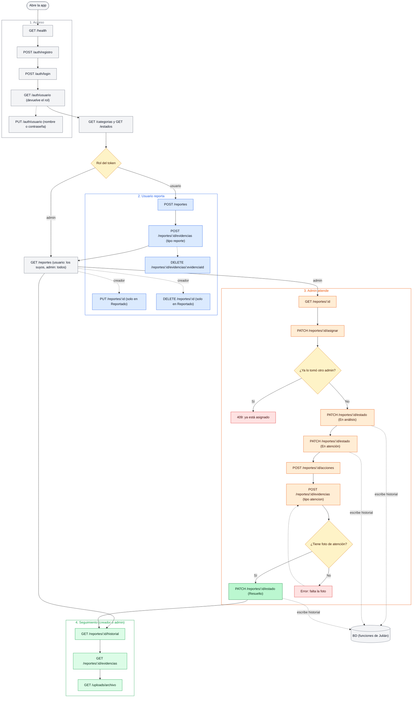

# API de Waypoint

> **Versión 0: borrador de endpoints (issue #6).** Aquí solo está la lista de rutas, quién puede usarlas y para qué. Los cuerpos JSON, las respuestas y los códigos de error se agregan en el contrato v1 (issue #9).

## Flujo

Cómo se usan los endpoints desde que se abre la app hasta que un reporte queda Resuelto. Las líneas punteadas son pasos opcionales. Versión editable en FigJam: [Flujo de endpoints de la API](https://www.figma.com/board/mJlzCNB4CAdCga5UVcq4mk).



## Roles

| Rol | Quién es |
|---|---|
| `usuario` | Reporta obstáculos y consulta el seguimiento de sus reportes |
| `admin` | Analiza los reportes, cambia su estado, documenta las acciones correctivas y sube la foto de la atención |

Todas las cuentas que se crean con `POST /auth/registro` nacen como `usuario`. Los admin vienen de la semilla de la BD.

En las tablas, **"creador"** no es un rol: es el usuario que hizo ese reporte. Un usuario no puede ver ni modificar los reportes de otro.

Los permisos se comprueban en el backend en cada ruta. Las rutas que no son públicas piden el token del login en el encabezado `Authorization: Bearer <token>`.

## Estados

`Reportado → En análisis → En atención → Resuelto`

- Solo el admin cambia el estado, un paso a la vez. No hay saltos ni retrocesos.
- Solo el admin asignado al reporte puede cambiar su estado.
- Para pasar a Resuelto debe existir al menos una evidencia de tipo `atencion`.
- Cada cambio de estado queda en el historial.

## Endpoints

### Acceso

| Método | Ruta | Quién | Para qué | Issue |
|---|---|---|---|---|
| `GET` | `/health` | Público | Comprobar que el servidor responde. La app lo usa para saber si hay conexión | #17 |
| `POST` | `/auth/registro` | Público | Crear una cuenta con rol `usuario` | #24 |
| `POST` | `/auth/login` | Público | Iniciar sesión y recibir el token | #24 |
| `GET` | `/auth/usuario` | Autenticado | Datos del usuario de la sesión, incluido su rol. Es la misma ruta para `usuario` y `admin` | #24 |
| `PUT` | `/auth/usuario` | Autenticado | Editar su nombre o su contraseña desde la pantalla de perfil. Para cambiar la contraseña pide la actual. No permite cambiar el rol | #24 |

### Catálogos

| Método | Ruta | Quién | Para qué | Issue |
|---|---|---|---|---|
| `GET` | `/categorias` | Autenticado | Lista de categorías para el formulario. Solo lectura: las categorías vienen de la semilla de la BD | #31 |
| `GET` | `/estados` | Autenticado | Los 4 estados en orden, para que la app no los tenga fijos en su código (filtros y seguimiento) | #31 |

### Reportes

| Método | Ruta | Quién | Para qué | Issue |
|---|---|---|---|---|
| `POST` | `/reportes` | `usuario` | Crear un reporte con categoría, descripción y ubicación. Nace en Reportado | #30 |
| `GET` | `/reportes` | Autenticado | Un solo endpoint: el `usuario` recibe solo los suyos y el `admin` recibe todos. Filtros opcionales: `?estado=&categoria=&q=` | #30 |
| `GET` | `/reportes/:id` | Creador o `admin` | Detalle del reporte | #30 |
| `PUT` | `/reportes/:id` | Creador, solo en Reportado | Modificar el reporte. Cuando el admin lo empieza a analizar ya no se puede editar | #30 |
| `DELETE` | `/reportes/:id` | Creador, solo en Reportado | Cancelar el reporte (eliminación lógica, no se borra de la BD) | #30 |

### Evidencias

| Método | Ruta | Quién | Para qué | Issue |
|---|---|---|---|---|
| `POST` | `/reportes/:id/evidencias` | Creador o `admin` asignado | Subir una foto. El backend decide el tipo según el rol: `reporte` si la sube el usuario, `atencion` si la sube el admin | #45 |
| `GET` | `/reportes/:id/evidencias` | Creador o `admin` | Fotos del reporte, de los dos tipos | #45 |
| `DELETE` | `/reportes/:id/evidencias/:evidenciaId` | Quien la subió | Quitar una foto subida por error. El creador solo mientras el reporte está en Reportado; el admin, sus fotos de `atencion` mientras no esté Resuelto. Si es la única foto de atención, el reporte ya no puede pasar a Resuelto | #45 |
| `GET` | `/uploads/<archivo>` | Autenticado | Mostrar la imagen en la app. No es un controlador: es la carpeta de imágenes servida por el servidor | #45 |

El reporte se crea primero (`POST /reportes`, en JSON) y las fotos se suben después, una por petición. Así un solo endpoint de subida sirve para los dos roles.

### Historial

| Método | Ruta | Quién | Para qué | Issue |
|---|---|---|---|---|
| `GET` | `/reportes/:id/historial` | Creador o `admin` | Seguimiento completo: quién hizo cada cambio, cuándo y de qué estado a cuál | #46 |

### Administración (solo `admin`)

| Método | Ruta | Para qué | Issue |
|---|---|---|---|
| `PATCH` | `/reportes/:id/asignar` | El admin toma el reporte. Si otro admin ya lo tomó, responde error | #38 |
| `PATCH` | `/reportes/:id/estado` | Avanzar al siguiente estado. Valida la transición y, para Resuelto, que exista la foto de atención | #36, #37, #38 |
| `POST` | `/reportes/:id/acciones` | Registrar una acción correctiva (por ejemplo, "se colocó una rampa temporal") | #38 |

Se dejan separados a propósito, en lugar de un solo `PATCH /reportes/:id` con campos opcionales: cada uno tiene permisos, validaciones e historial distintos, y así se prueban y se explican por separado.

Un usuario común que llame a estas rutas recibe `403`.

## Concurrencia

Si dos admin intentan tomar el mismo reporte al mismo tiempo, no se usa un bloqueo. La actualización lleva la condición en el `WHERE` y la BD la ejecuta de forma atómica:

```sql
UPDATE reportes SET <admin asignado> = 12 WHERE id = 7 AND <admin asignado> IS NULL;
```

Si afecta 0 filas, otro admin llegó primero y la API responde `409`. El cambio de estado funciona igual: `... WHERE id = 7 AND estado = 'En analisis'`. Si el estado ya cambió, la API responde `409` en lugar de pisar el cambio.

## Preguntas abiertas

**Para Julián (BD):**
1. Las acciones correctivas, ¿se guardan en el historial (sin cambio de estado) o en una tabla propia?
2. Para `GET /reportes` con un solo endpoint, ¿tu función de listar puede recibir el id del usuario como filtro opcional?
3. Para la concurrencia, ¿tus funciones de asignar y de cambiar estado pueden devolver cuántas filas se actualizaron?
4. Para `GET /estados`: ¿los estados van en una tabla de catálogo o como lista fija (`CHECK` o `ENUM`) en la columna de reportes?
5. Para `PUT /auth/usuario` y `DELETE /reportes/:id/evidencias/:evidenciaId`: ¿puedes agregar a `docs/db-functions.md` una función para actualizar nombre y hash de contraseña, y otra para borrar el registro de una evidencia que devuelva su ruta? El archivo en disco lo borra la API, porque la subida de imágenes es parte del backend.